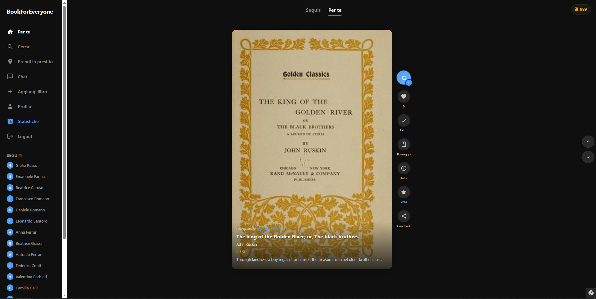
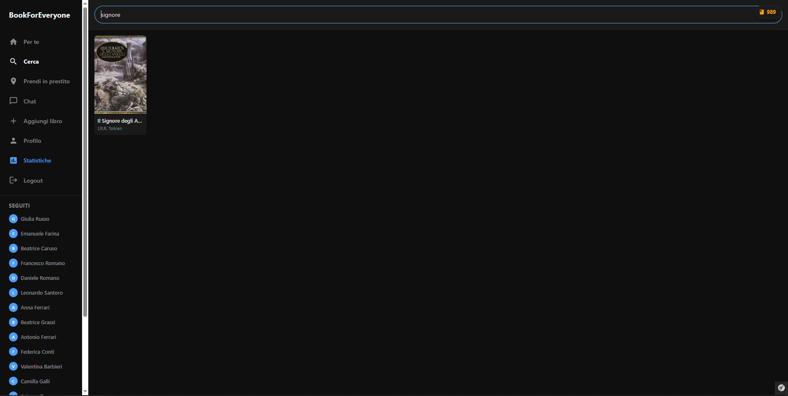
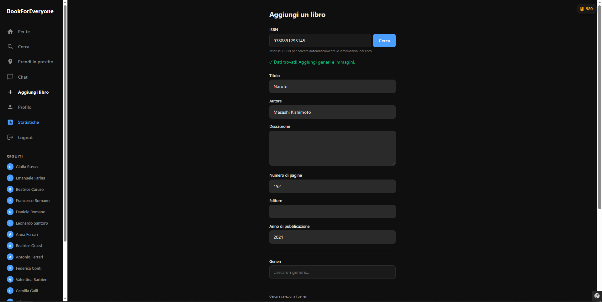
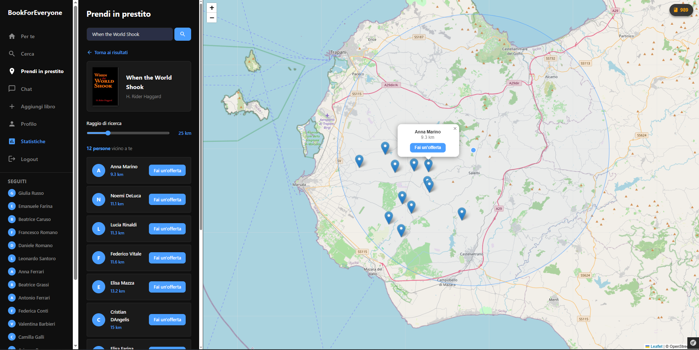
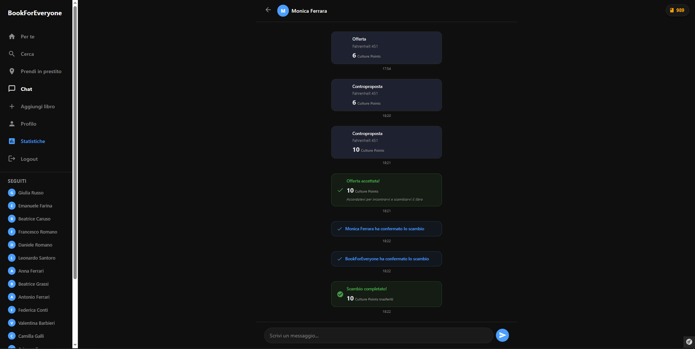
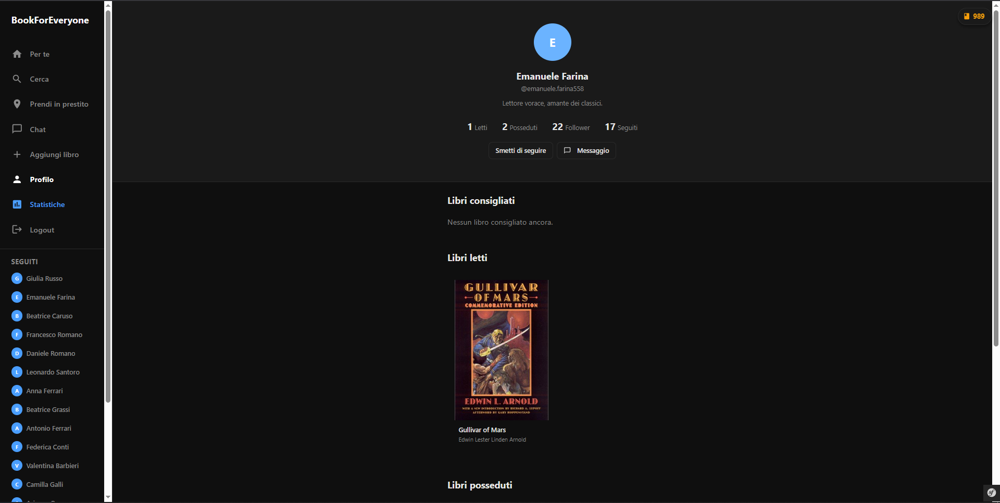
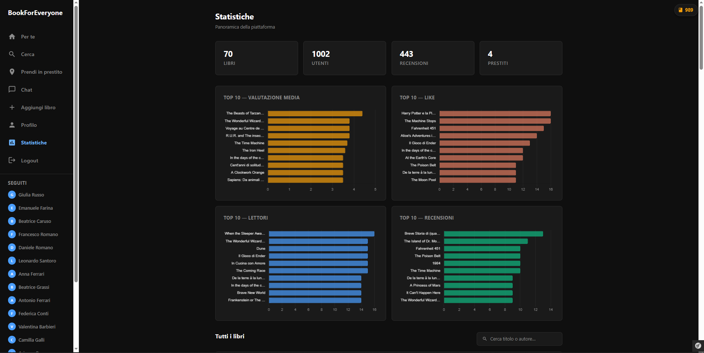

# BookForEveryone

**BookForEveryone** è una piattaforma sociale per la condivisione e il prestito di libri fisici tra lettori. Gli utenti possono scoprire nuovi titoli attraverso un feed personalizzato, cercare opere nel catalogo, richiedere il prestito di copie fisiche possedute da altri iscritti e comunicare in tempo reale tramite una chat integrata.

## Avvio rapido

```bash
docker-compose up -d
```

Apri [http://localhost:8000](http://localhost:8000)

**Credenziali di accesso (ambiente di test)**

| Campo    | Valore                      |
|----------|-----------------------------|
| Username | `bookforeveryone`           |
| Email    | `bookforeveryone@gmail.com` |
| Password | `prova`                     |

Tutti gli utenti di test condividono la password `prova`.

**Ricreare il database da zero**

```bash
docker-compose up -d --build
.\setup-database.bat
```

## Stack tecnologico

| Componente                    | Tecnologia              |
|-------------------------------|-------------------------|
| Framework backend             | Symfony 8.0 (PHP 8.4)   |
| ORM                           | Doctrine ORM 3          |
| Database                      | MariaDB 11.8            |
| Cache e code di messaggi      | Redis                   |
| Messaggistica in tempo reale  | Mercure (SSE)           |
| Frontend                      | Twig + Asset Mapper     |
| Mappe interattive             | Leaflet.js              |
| Containerizzazione            | Docker                  |

**Dati di test precaricati**
- 1.000 utenti posizionati a Mazara del Vallo (Sicilia)
- 70 libri con copertine recuperate da Open Library

---

## Funzionalità principali

### Feed — *Per te*



La schermata principale propone all'utente un feed di libri selezionati in base alle preferenze letterarie dichiarate durante la registrazione. Ciascuna scheda mostra la copertina, il titolo, l'autore e le azioni rapide disponibili: assegnare un *mi piace*, segnare il libro come letto, indicare il possesso della copia fisica, condividerlo o lasciare una recensione con valutazione in stelle. Il feed supporta lo scorrimento infinito con caricamento progressivo dei contenuti.

---

### Ricerca



La sezione di ricerca consente di individuare titoli presenti nel catalogo tramite una barra di testo. I risultati vengono visualizzati in forma di griglia con copertina, titolo e autore, permettendo una navigazione immediata verso la scheda dettaglio del volume selezionato.

---

### Aggiunta di un libro



Gli utenti registrati possono contribuire al catalogo aggiungendo nuovi titoli. Il modulo di inserimento integra un meccanismo di ricerca automatica per ISBN: digitando il codice identificativo, il sistema interroga le API di Google Books e Open Library per recuperare automaticamente titolo, autore, numero di pagine, editore e anno di pubblicazione. L'utente completa la scheda selezionando i generi letterari e, facoltativamente, caricando fotografie personali del volume.

---

### Prendi in prestito



La funzionalità di prestito consente di ricercare utenti che possiedono fisicamente un determinato titolo e si trovano nelle vicinanze. I risultati vengono presentati sia in forma di elenco — con la distanza calcolata rispetto alla posizione dell'utente corrente — sia su una mappa interattiva basata su Leaflet.js. Per ciascun possessore è disponibile un pulsante per avviare direttamente la negoziazione del prestito.

---

### Chat e ciclo di vita del prestito



La chat in tempo reale, implementata tramite il protocollo Mercure (Server-Sent Events), accompagna l'intero ciclo di vita di una richiesta di prestito. All'interno della conversazione vengono registrati tutti gli eventi significativi della trattativa: l'offerta iniziale espressa in *Culture Points*, le eventuali controproposte, l'accettazione dell'accordo e la conferma fisica dello scambio da parte di entrambe le parti. Al termine, i punti concordati vengono trasferiti automaticamente dal richiedente al prestatore.

---

### Profilo utente



La pagina di profilo raccoglie le informazioni pubbliche dell'utente: nome, username, biografia e contatori relativi a libri letti, copie possedute, follower e seguiti. Sono inoltre elencate le raccolte personali distinte per categoria — *libri consigliati*, *libri letti* e *libri posseduti* — con le rispettive copertine. Gli utenti autenticati possono seguire il profilo visualizzato o inviare un messaggio direttamente dalla stessa pagina.

---

### Statistiche della piattaforma



La sezione statistiche offre una panoramica aggregata dell'attività della piattaforma. Quattro indicatori sommari mostrano il numero totale di libri catalogati, utenti iscritti, recensioni scritte e prestiti effettuati. Quattro grafici a barre orizzontali evidenziano le classifiche *Top 10* per valutazione media, numero di *mi piace*, lettori e recensioni ricevute. In calce è presente un catalogo completo con ricerca per titolo o autore.

---

## Note operative

| Operazione     | Comando                               |
|----------------|---------------------------------------|
| Avvio          | `docker-compose up -d`                |
| Arresto        | `docker-compose down`                 |
| Reset database | `docker-compose down -v` → `.\setup-database.bat` |
| Dati           | Persistiti in `docker/db/data/`       |
